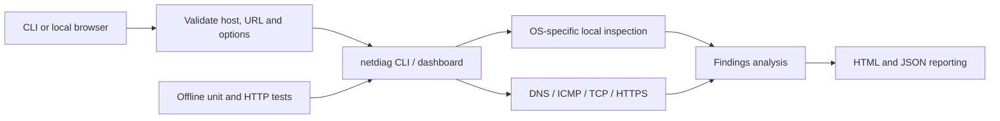

# Architecture — Network Diagnostic Tool

**Status:** user-initiated network diagnostics; local-only browser dashboard; no network configuration changes.

## Code map

| Component | Files | Responsibility |
| --- | --- | --- |
| CLI entry point | `netdiag/__main__.py`, `netdiag/cli.py` | Supported arguments, demo mode, reports |
| Dashboard + HTTP validation | `netdiag/dashboard.py`, `netdiag/dashboard_assets/` | Loopback UI and controlled actions |
| Local inspection | `netdiag/local.py` | Parse network settings on macOS/Windows/Linux |
| Active probes | `netdiag/probes.py` | DNS, ICMP ping, TCP and HTTPS checks |
| Findings | `netdiag/analysis.py` | Interpret results with explicit WARN/FAIL distinction |
| Export | `netdiag/report.py` | Human-readable HTML and machine-readable JSON |
| Verification | `tests/test_diagnostics.py`, `tests/test_dashboard.py`, `tests/test_recruiter_regressions.py` | Parser, probe, reporting and HTTP behaviour |

## Important troubleshooting reasoning

**No ping reply ≠ certain internet outage.** ICMP can be blocked; confirm with DNS, TCP and HTTPS. **DNS lookup failure** leads to a different next step than a **closed TCP port**. Do not use a successful DNS resolution as proof that a service is healthy. Always record the test target and timeout.

## Privacy and security

The dashboard binds to `127.0.0.1`, not a public interface. Commands and outgoing probes run only on explicit requests, except selected local inspection. Reports may contain hostnames, private IPs and target data; review/redact before sharing. `--demo` uses fictional examples and avoids device/network inspection.

**Not provided:** automated agent deployment, enterprise asset inventory, vulnerability scanning or guaranteed root-cause attribution.
